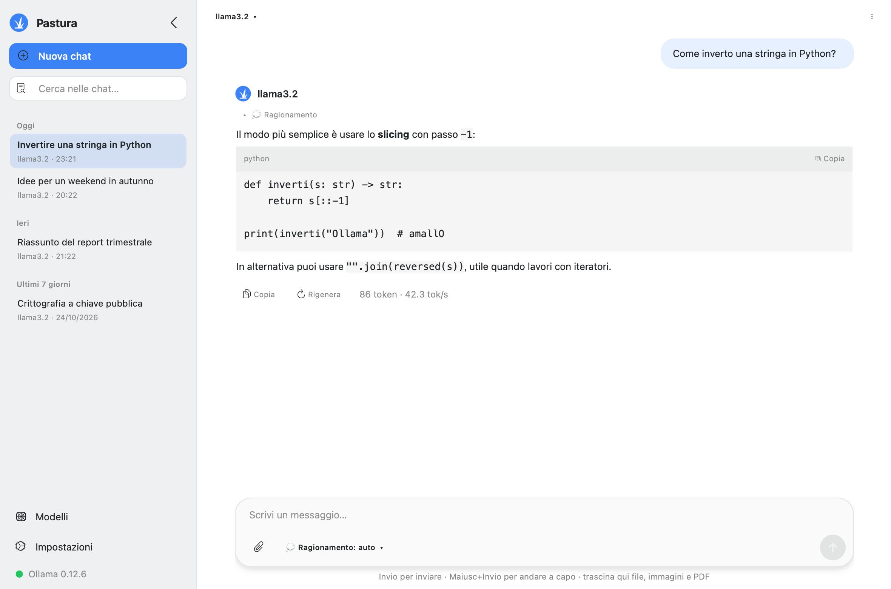
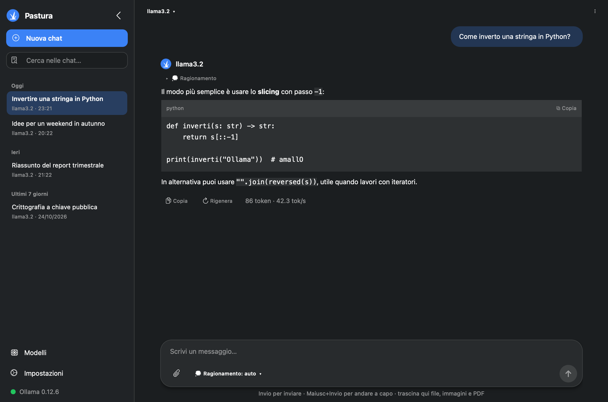
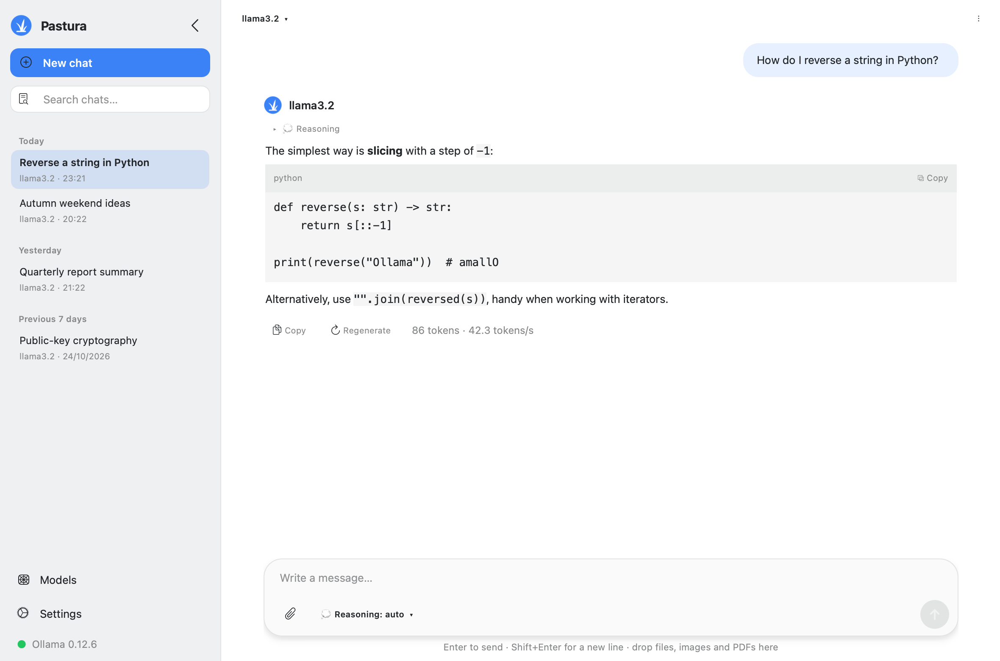
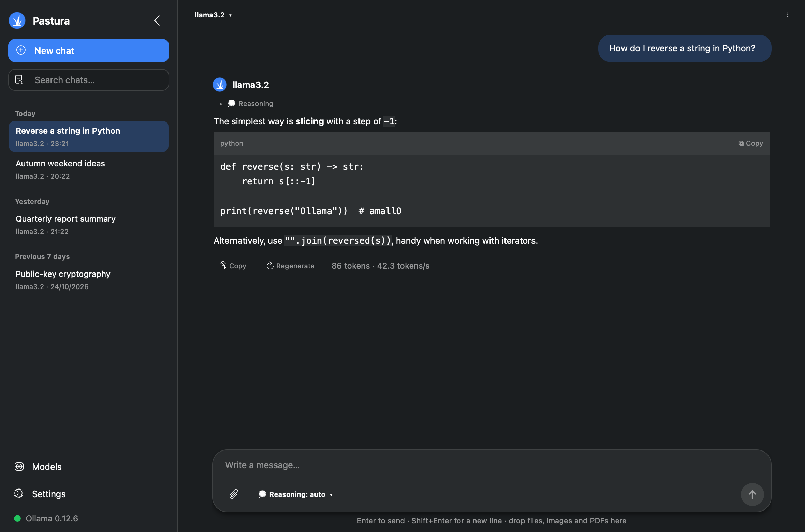

<p align="center"></p>

<h1 align="center">Pastura</h1>

<p align="center">
<b>A native Qt desktop client for Ollama on Linux</b><br>
<i>Un client desktop Qt nativo per Ollama su Linux</i>
</p>

<p align="center"><b><a href="#italiano">Italiano</a></b> · <b><a href="#english">English</a></b></p>

---

## Italiano

| Tema chiaro | Tema scuro |
|:---:|:---:|
|  |  |

**Pastura** è un client desktop per [Ollama](https://ollama.com) su Linux, scritto in Python con Qt (PySide6).
Offre le stesse funzioni dell'app ufficiale per Windows e si integra bene con KDE Plasma
(e con qualsiasi altro desktop che supporti Qt).

> Pastura è un progetto indipendente e non è affiliato a Ollama.

### Funzionalità

- **Interfaccia moderna** che segue il tema di sistema (chiaro/scuro e colore d'accento di KDE)
- **Chat in streaming** con rendering Markdown e blocchi di codice copiabili con un clic
- **Cronologia delle conversazioni** raggruppata per data: ricerca, rinomina, eliminazione, esportazione in Markdown
- **Gestione dei modelli**: elenco dei modelli installati (dimensione, parametri, quantizzazione),
  download (`pull`) con barra di avanzamento, eliminazione, scaricamento dalla memoria
- **Libreria di Ollama integrata**: cerca i modelli di ollama.com (anche quelli della community),
  filtra per funzione (strumenti, ragionamento, visione, …), guarda varianti, dimensioni e contesto
  e scaricali con un doppio clic, senza aprire il browser
- **Allegati**:
  - immagini (`.png`, `.jpg`, `.webp`, `.gif`, `.bmp`) per i modelli con visione,
    ridimensionate automaticamente a max 2048 px
  - file di testo e codice
  - PDF (il testo viene estratto con `pypdf`)
  - si aggiungono trascinandoli nella finestra, con il pulsante dedicato o incollando un'immagine
- **Modalità ragionamento** (*thinking*) per i modelli che la supportano: automatica, attiva o disattiva
- **Rigenera** la risposta, **ferma** la generazione, **copia** la risposta, statistiche in token/s
- **Avvio del server Ollama** dall'interfaccia se non è in esecuzione
  (tramite `systemctl` con `pkexec`, oppure `ollama serve`)
- **Icona nella barra di sistema**, con opzione di riduzione a icona alla chiusura
- **Aspetto e lingua**: tema chiaro/scuro o di sistema, colore d'accento, interfaccia in italiano o inglese
  (automatica in base alla lingua del sistema)

### Requisiti

- Linux con Python ≥ 3.9
- [Ollama](https://ollama.com) installato in locale, oppure raggiungibile in rete
- Dipendenze Python (vedi [requirements.txt](requirements.txt)):
  - `PySide6` ≥ 6.5
  - `requests` ≥ 2.28
  - `markdown` ≥ 3.4 (facoltativo: senza, si usa il rendering Markdown di Qt)
  - `pypdf` ≥ 4.0

Per installare Ollama:

```bash
curl -fsSL https://ollama.com/install.sh | sh
```

### Installazione

Lo script [install.sh](install.sh) installa l'applicazione nella home dell'utente, senza privilegi di root:

```bash
./install.sh
```

Lo script:

1. copia i file in `~/.local/share/pastura-app/`
2. crea un ambiente virtuale Python e vi installa le dipendenze
3. crea il comando `~/.local/bin/pastura`
4. aggiunge la voce **Pastura** al menu delle applicazioni e installa l'icona in
   `~/.local/share/icons/hicolor/scalable/apps/pastura.svg`
5. rimuove la vecchia installazione col nome *Ollama GUI*, se presente

**Aggiornamento da kde-ollama-gui:** al primo avvio Pastura sposta impostazioni e cronologia
da `~/.config/ollama-gui` e `~/.local/share/ollama-gui` nelle nuove cartelle (solo se queste
non esistono ancora), quindi non perdi nulla.

Se `~/.local/bin` non è nel `PATH`, aggiungilo (per esempio in `~/.bashrc`):

```bash
export PATH="$HOME/.local/bin:$PATH"
```

#### Avvio senza installazione

```bash
python3 -m venv venv
./venv/bin/pip install -r requirements.txt
./venv/bin/python pastura.py
```

#### Disinstallazione

```bash
rm -rf ~/.local/share/pastura-app
rm -f ~/.local/bin/pastura ~/.local/share/applications/pastura.desktop
rm -f ~/.local/share/icons/hicolor/scalable/apps/pastura.svg
```

Per eliminare anche impostazioni e cronologia, rimuovi le cartelle `~/.config/pastura`
e `~/.local/share/pastura`.

### Uso

Avvia `pastura` dal terminale oppure dal menu delle applicazioni. Scegli un modello
dal menu in alto a sinistra (o scaricane uno con **Modelli** nella barra laterale) e inizia a scrivere.
Le altre azioni sono nel menu **⋮** in alto a destra.

#### Scorciatoie da tastiera

| Tasto            | Azione                     |
|------------------|----------------------------|
| `Invio`          | Invia il messaggio         |
| `Maiusc+Invio`   | Vai a capo                 |
| `Ctrl+N`         | Nuova chat                 |
| `Ctrl+L`         | Sposta il cursore sul campo di testo |
| `Ctrl+,`         | Impostazioni               |
| `Ctrl+M`         | Modelli                    |
| `Ctrl+B`         | Mostra/nascondi la barra laterale |
| `Ctrl+R`         | Rigenera la risposta       |
| `Ctrl+Shift+C`   | Copia l'ultima risposta    |
| `Ctrl+E`         | Esporta la chat in Markdown |
| `F2`             | Rinomina la chat           |
| `Esc`            | Ferma la generazione       |
| `Ctrl+Q`         | Esci                       |

### Configurazione

Dalla finestra **Impostazioni** (`Ctrl+,`) si possono impostare:

- **Indirizzo del server**: predefinito `127.0.0.1:11434`, oppure il valore della variabile
  d'ambiente `OLLAMA_HOST`. Il pulsante *Verifica* controlla la connessione.
  Per usare Ollama su un altro computer, indica per esempio `http://192.168.1.50:11434`.
- **Lunghezza del contesto** (`num_ctx`)
- **Temperatura**
- **Mantieni in memoria** (`keep_alive`): vuoto = 5m, `-1` = sempre, `0` = scarica subito, `30m`, …
- **Mostra il ragionamento** dei modelli
- **Riduzione nella barra di sistema** alla chiusura della finestra
- **Prompt di sistema**, inviato all'inizio di ogni conversazione
- **Aspetto**: tema (sistema, chiaro, scuro), colore d'accento e lingua dell'interfaccia
  (automatica, italiano, inglese; la lingua si applica al riavvio)

Ogni opzione lasciata al valore predefinito usa le impostazioni del modello.

#### Impostazioni del server

Alcune opzioni (cartella dei modelli, accesso dalla rete) appartengono al server Ollama,
non all'interfaccia. Con systemd:

```bash
sudo systemctl edit ollama
```

```ini
[Service]
Environment="OLLAMA_HOST=0.0.0.0:11434"
Environment="OLLAMA_MODELS=/percorso/dei/modelli"
Environment="OLLAMA_CONTEXT_LENGTH=8192"
Environment="OLLAMA_KEEP_ALIVE=30m"
```

```bash
sudo systemctl daemon-reload
sudo systemctl restart ollama
```

- `OLLAMA_HOST=0.0.0.0:11434` espone Ollama alla rete locale (ricordati di aprire la porta nel firewall).
- La cartella indicata in `OLLAMA_MODELS` deve appartenere all'utente `ollama`
  (`sudo chown -R ollama:ollama /percorso`).

### File e dati

L'applicazione segue le specifiche XDG:

| Percorso                                              | Contenuto                                  |
|-------------------------------------------------------|--------------------------------------------|
| `~/.config/pastura/settings.json`                     | Impostazioni                               |
| `~/.local/share/pastura/chats/`                       | Conversazioni salvate (un file JSON ciascuna) |
| `~/.local/share/pastura-app/`                         | Programma e ambiente virtuale (se installato con `install.sh`) |
| `~/.local/share/icons/hicolor/scalable/apps/pastura.svg` | Icona dell'applicazione (se installato con `install.sh`) |

Chi aggiorna da kde-ollama-gui trova impostazioni e chat spostate automaticamente da
`~/.config/ollama-gui` e `~/.local/share/ollama-gui` al primo avvio.

Le conversazioni restano solo sul tuo computer; l'applicazione comunica esclusivamente con
il server Ollama configurato.

### Test

```bash
pip install -r requirements-dev.txt
python -m pytest
```

I test girano senza aprire finestre (`QT_QPA_PLATFORM=offscreen`), usano cartelle temporanee
e non contattano il server Ollama.

### Licenza

Distribuito con licenza [MIT](LICENSE).

---

## English

| Light theme | Dark theme |
|:---:|:---:|
|  |  |

**Pastura** is a native desktop client for [Ollama](https://ollama.com) on Linux, written in Python with Qt (PySide6).
It provides the same features as the official Windows app and integrates well with KDE Plasma
(and any other desktop that supports Qt).

> Pastura is an independent project and is not affiliated with Ollama.

### Features

- **Modern interface** that follows the system theme (light/dark and KDE accent colour)
- **Streaming chat** with Markdown rendering and one-click copyable code blocks
- **Conversation history** grouped by date: search, rename, delete, export to Markdown
- **Model management**: list installed models (size, parameters, quantization),
  download (`pull`) with a progress bar, delete, unload from memory
- **Built-in Ollama library**: search the models on ollama.com (community ones included),
  filter by capability (tools, thinking, vision, …), browse tags, sizes and context length
  and download them with a double click, without opening the browser
- **Attachments**:
  - images (`.png`, `.jpg`, `.webp`, `.gif`, `.bmp`) for vision models,
    automatically resized to at most 2048 px
  - text and source code files
  - PDFs (text is extracted with `pypdf`)
  - add them by dragging them onto the window, with the attach button, or by pasting an image
- **Thinking mode** for models that support it: auto, on, or off
- **Regenerate** a reply, **stop** generation, **copy** a reply, tokens/s statistics
- **Start the Ollama server** from the GUI if it isn't running
  (via `systemctl` with `pkexec`, or `ollama serve`)
- **System tray icon**, with an option to minimize to the tray on close
- **Appearance and language**: light/dark or system theme, accent colour, Italian or English interface
  (automatic, based on the system language)

### Requirements

- Linux with Python ≥ 3.9
- [Ollama](https://ollama.com) installed locally, or reachable over the network
- Python dependencies (see [requirements.txt](requirements.txt)):
  - `PySide6` ≥ 6.5
  - `requests` ≥ 2.28
  - `markdown` ≥ 3.4 (optional: without it, Qt's built-in Markdown rendering is used)
  - `pypdf` ≥ 4.0

To install Ollama:

```bash
curl -fsSL https://ollama.com/install.sh | sh
```

### Installation

The [install.sh](install.sh) script installs the application in your home directory, without root privileges:

```bash
./install.sh
```

The script:

1. copies the files to `~/.local/share/pastura-app/`
2. creates a Python virtual environment and installs the dependencies into it
3. creates the `~/.local/bin/pastura` command
4. adds a **Pastura** entry to the application menu and installs the icon in
   `~/.local/share/icons/hicolor/scalable/apps/pastura.svg`
5. removes the old installation under the *Ollama GUI* name, if present

**Upgrading from kde-ollama-gui:** on first launch Pastura moves your settings and chat history
from `~/.config/ollama-gui` and `~/.local/share/ollama-gui` to the new folders (only if those
don't exist yet), so nothing is lost.

If `~/.local/bin` is not in your `PATH`, add it (for example in `~/.bashrc`):

```bash
export PATH="$HOME/.local/bin:$PATH"
```

#### Running without installing

```bash
python3 -m venv venv
./venv/bin/pip install -r requirements.txt
./venv/bin/python pastura.py
```

#### Uninstalling

```bash
rm -rf ~/.local/share/pastura-app
rm -f ~/.local/bin/pastura ~/.local/share/applications/pastura.desktop
rm -f ~/.local/share/icons/hicolor/scalable/apps/pastura.svg
```

To also delete settings and chat history, remove the `~/.config/pastura`
and `~/.local/share/pastura` directories.

### Usage

Launch `pastura` from a terminal or from the application menu. Pick a model
from the menu at the top left (or download one with **Models** in the sidebar) and start typing.
The other actions are in the **⋮** menu at the top right.

#### Keyboard shortcuts

| Key              | Action                     |
|------------------|----------------------------|
| `Enter`          | Send the message           |
| `Shift+Enter`    | New line                   |
| `Ctrl+N`         | New chat                   |
| `Ctrl+L`         | Focus the message input    |
| `Ctrl+,`         | Settings                   |
| `Ctrl+M`         | Models                     |
| `Ctrl+B`         | Show/hide the sidebar      |
| `Ctrl+R`         | Regenerate the answer      |
| `Ctrl+Shift+C`   | Copy the last answer       |
| `Ctrl+E`         | Export the chat to Markdown |
| `F2`             | Rename the chat            |
| `Esc`            | Stop generation            |
| `Ctrl+Q`         | Quit                       |

### Configuration

The **Settings** dialog (`Ctrl+,`) lets you set:

- **Server address**: defaults to `127.0.0.1:11434`, or the value of the `OLLAMA_HOST`
  environment variable. The *Test* button checks the connection.
  To use Ollama on another computer, enter for example `http://192.168.1.50:11434`.
- **Context length** (`num_ctx`)
- **Temperature**
- **Keep in memory** (`keep_alive`): empty = 5m, `-1` = forever, `0` = unload immediately, `30m`, …
- **Show the reasoning** (thinking) of models
- **Minimize to the system tray** when the window is closed
- **System prompt**, sent at the start of every conversation
- **Appearance**: theme (system, light, dark), accent colour and interface language
  (automatic, Italian, English; the language is applied after a restart)

Any option left at its default uses the model's own setting.

#### Server settings

Some options (model directory, network access) belong to the Ollama server,
not to the GUI. With systemd:

```bash
sudo systemctl edit ollama
```

```ini
[Service]
Environment="OLLAMA_HOST=0.0.0.0:11434"
Environment="OLLAMA_MODELS=/path/to/models"
Environment="OLLAMA_CONTEXT_LENGTH=8192"
Environment="OLLAMA_KEEP_ALIVE=30m"
```

```bash
sudo systemctl daemon-reload
sudo systemctl restart ollama
```

- `OLLAMA_HOST=0.0.0.0:11434` exposes Ollama to your local network (remember to open the port in the firewall).
- The directory set in `OLLAMA_MODELS` must be owned by the `ollama` user
  (`sudo chown -R ollama:ollama /path`).

### Files and data

The application follows the XDG specifications:

| Path                                                  | Contents                                   |
|-------------------------------------------------------|--------------------------------------------|
| `~/.config/pastura/settings.json`                     | Settings                                   |
| `~/.local/share/pastura/chats/`                       | Saved conversations (one JSON file each)   |
| `~/.local/share/pastura-app/`                         | Program and virtual environment (if installed with `install.sh`) |
| `~/.local/share/icons/hicolor/scalable/apps/pastura.svg` | Application icon (if installed with `install.sh`) |

If you upgrade from kde-ollama-gui, settings and chats are moved automatically from
`~/.config/ollama-gui` and `~/.local/share/ollama-gui` on first launch.

Conversations stay on your computer; the application only talks to the configured Ollama server.

### Tests

```bash
pip install -r requirements-dev.txt
python -m pytest
```

Tests run without opening windows (`QT_QPA_PLATFORM=offscreen`), use temporary folders
and never contact the Ollama server.

### License

Released under the [MIT](LICENSE) license.
